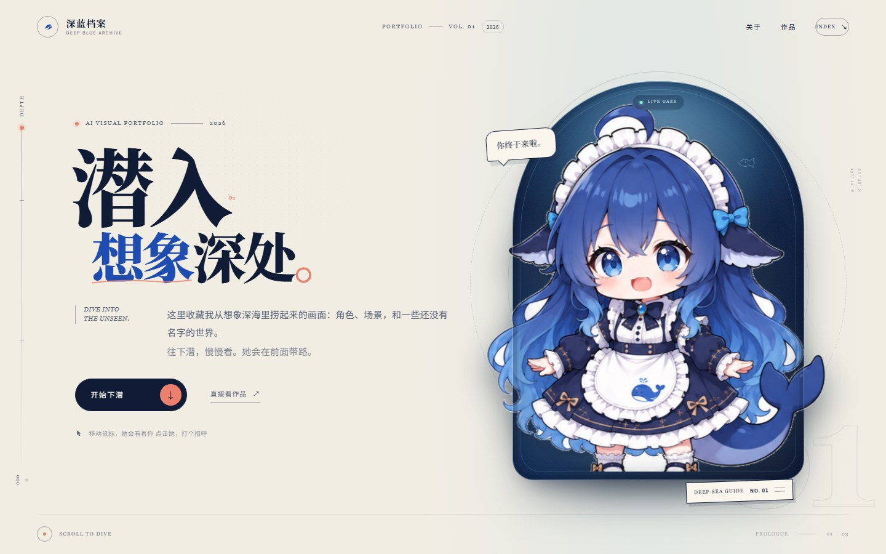
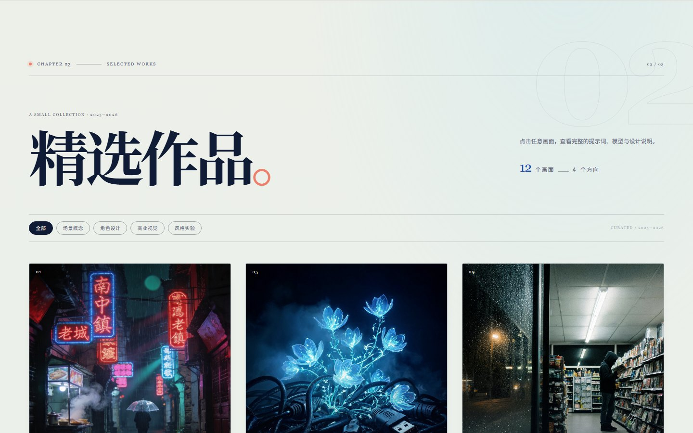
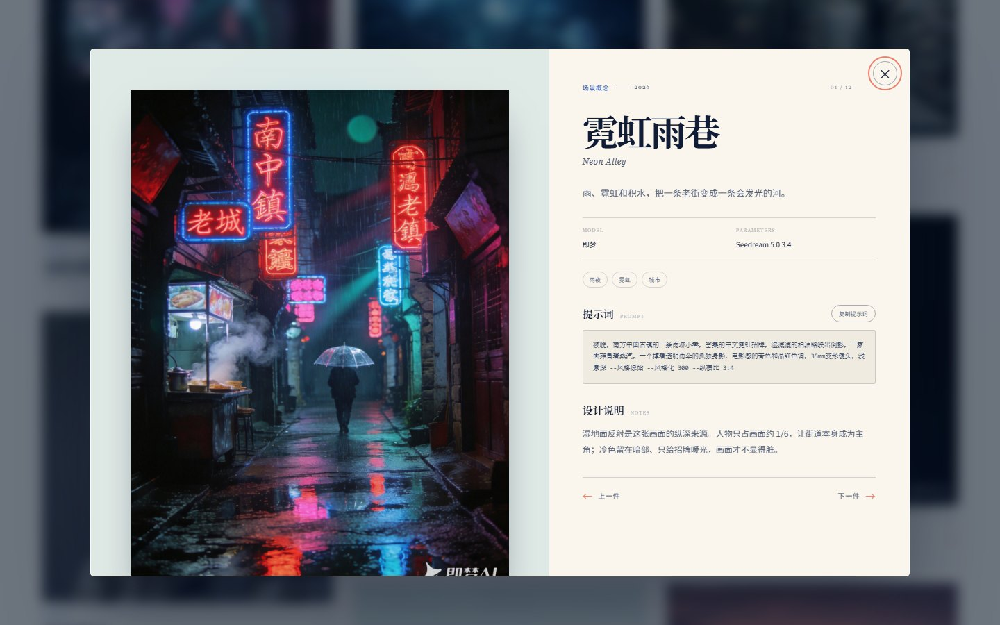

# 深蓝档案 · 作品集

一个可以直接在浏览器打开的单页作品集。角色会看着你的鼠标；往下翻，先是一段关于这本档案的说明，然后是 12 件精选作品，点开任意一件，都能看到完整的提示词、模型参数和设计说明。

纯静态 HTML / CSS / JavaScript，零依赖、零构建。







---

## 打开方式

双击 `index.html` 即可在浏览器里查看，不需要安装任何东西。

如果想用本地服务器预览：

```bash
cd deep-blue-portfolio
python -m http.server 8000
```

然后访问 `http://127.0.0.1:8000`。

---

## 这一版包含什么

- **视线跟随**：左右眼珠是独立图层，会跟着鼠标方向移动；鼠标离开后回到自然的注视状态。
- **点击回应**：点击角色会触发一个轻微的跳跃动作、气泡台词和气泡粒子。
- **精选作品**：12 件作品，支持按「场景概念 / 角色设计 / 商业视觉 / 风格实验」筛选；浅色海玻璃背景，不沿用旧版的黑色底。
- **作品详情**：点击任意作品，打开浅色详情弹窗，可查看完整提示词、模型、参数、标签与设计说明，并一键复制提示词。
- **说话气泡**：默认说「你终于来啦。」，点击后会换一句回应，鼠标停在「开始下潜」按钮上也会触发提示。
- **水下舷窗**：深海光斑、上升气泡、漂浮小鱼、轨道线，全部由 CSS / 内联 SVG 绘制。
- **沉浸式开场**：下潜加载页、标题逐行出现、完整角色从舷窗里上浮入场。
- **响应式**：桌面、平板、手机都有单独排版；手机上会把角色完整收进首屏。
- **可访问性**：角色支持键盘 `Enter` / `Space` 互动，作品卡片和详情弹窗都可以用键盘操作；支持系统「减少动效」设置。
- **章节顺序**：开场 → 关于这本档案 → 精选作品 → 回到海面。

---

## 文件结构

```
deep-blue-portfolio/
├── index.html              ← 页面结构、文案
├── preview.jpg             ← 开场预览
├── preview-works.jpg       ← 精选作品预览
├── preview-detail.jpg      ← 作品详情预览
├── assets/
│   ├── css/style.css       ← 全部样式、动效、作品画廊与详情弹窗
│   ├── js/
│   │   ├── main.js         ← 视线、角色互动、深度尺、入场逻辑
│   │   ├── works.js        ← ★ 作品数据：标题、分类、提示词、说明
│   │   └── gallery.js      ← 筛选、画廊渲染、详情弹窗
│   └── img/
│       ├── mascot-base.png ← 角色底图（已去掉眼珠）
│       ├── iris-left.png   ← 左眼珠图层
│       ├── iris-right.png  ← 右眼珠图层
│       ├── favicon.svg
│       └── works/          ← 12 张作品图（work-01.jpg … work-12.jpg）
├── .nojekyll
└── README.md
```

---

## 换作品 / 改作品说明

作品内容都在 `assets/js/works.js` 里。一件作品是一块：

```js
{
  id: "w01",
  title: "霓虹雨巷",
  en: "Neon Alley",
  category: "场景概念",       // 会出现在筛选按钮里
  year: "2026",
  image: "assets/img/works/work-01.jpg",
  w: 1200, h: 1512,          // 图片真实尺寸，用来稳定布局
  model: "Midjourney v6.1",
  params: "--style raw --stylize 300 --ar 3:4",
  desc: "一句话介绍，会显示在详情标题下方。",
  prompt: "完整提示词……",
  note: "设计说明，写你改了什么、为什么改。",
  tags: ["雨夜", "霓虹", "城市"]
}
```

换图时把同名文件放到 `assets/img/works/` 覆盖，或者改 `image` 路径；新的图片比例不同的话，同时改 `w` / `h`。

> 当前 12 张作品图已替换为编号 1–12 的成图，并压缩到长边 1600px。图片右下角保留了「即梦AI」水印；如果要去掉，可以裁掉底部少量画面或使用无水印版本。模型、参数、提示词和说明可在 `works.js` 中继续校对。

---

## 想改哪里

| 想改 | 去哪 |
|---|---|
| 标题、介绍、按钮文案 | `index.html`（搜「潜入」「开始下潜」） |
| 气泡台词 | `assets/js/main.js` 里的 `idleLines` / `greetLines` |
| 主色、纸张色、深海色 | `assets/css/style.css` 顶部的 `:root` |
| 角色大小 / 舷窗高度 | `style.css` 的 `.portal`、`.character` |
| 眼睛移动幅度 | `style.css` 的 `.iris` 里的 `8%` |
| 作品标题 / 分类 / 提示词 / 说明 | `assets/js/works.js` |
| 作品图片 | 覆盖 `assets/img/works/work-01.jpg` … `work-12.jpg` |
| 作品筛选 / 详情弹窗样式 | `style.css` 的 `.works-section`、`.work-dialog` |
| 页面标题和分享描述 | `index.html` 的 `<title>` / `<meta name="description">` |

角色底图和眼珠是分开的。如果要换角色，需要提供一张去掉眼珠的底图，再按原位置摆两颗眼珠；现在这版的眼睛位置写在 `.iris--left` / `.iris--right` 里。

---

## 部署到 GitHub Pages

1. 新建一个 Public 仓库，把整个 `deep-blue-portfolio` 文件夹里的内容上传到仓库根目录。
2. 仓库 **Settings → Pages**：
   - Source 选 `Deploy from a branch`
   - Branch 选 `main`，目录选 `/ (root)`
3. 等 1–3 分钟，访问 Pages 给出的链接。

`.nojekyll` 已经放在根目录，用来跳过 Jekyll 处理。

---

## 兼容性

最近两年的 Chrome / Edge / Safari / Firefox 都可以。用到了 `aspect-ratio`、CSS mask、`svh` 和 `translate` 动画，这些在较新的浏览器里都支持。

如果浏览器禁用了 JavaScript，开场和关于部分仍然可以阅读；视线跟随、角色互动和作品画廊不会运行。

---

*角色设定来自提供的角色三视图。作品图片来自提供的编号成图。页面代码可自由修改使用。*
